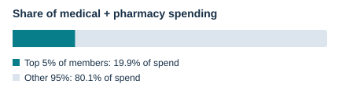
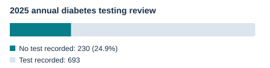
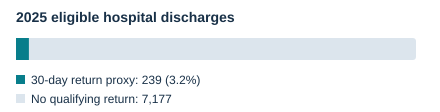

# Where is our cost concentrated, and which members could we help?

**Care management briefing | Synthetic demonstration**  
25,000 members · 2024–2025 · $206.63 million in medical and pharmacy payments.

| What we found | Dashboard chart |
| :--- | :--- |
| **1. A small group accounts for a large share of spending.** The highest-cost 5% (1,250 members) account for **19.9% of payments**, or $41.04 million across both years. High past cost alone does not establish current care needs. |  |
| **2. 230 members have no annual diabetes blood-sugar test recorded in 2025.** That is **24.9% of 923 members** with a diabetes diagnosis recorded that year and a full year of coverage. |  |
| **3. 239 hospital discharges were followed by a return within 30 days in 2025.** This is **3.2% of 7,416 eligible discharges**; a member may have multiple discharges. It does not show that a return was preventable. |  |

**Recommended actions**

- Start by reviewing the **230 diabetes records**; confirm current coverage and whether testing happened elsewhere before offering help arranging follow-up.
- Review the **1,250 highest-cost members** with care managers, prioritizing confirmed unmet needs. Check overlap with the diabetes group before assigning outreach.
- Review the **239 hospital-return events** for follow-up opportunities. Track members reached, appointments completed and confirmed care gaps closed; do not assume savings.

**Caveats:** All people and payments are synthetic. Missing records may not mean missing care. These historical groups are not a current outreach list or a prediction. The readmission figure is a **proxy** with follow-up coverage checks, but without exclusions for planned returns, transfers or deaths; overlapping stays can also affect it. It is not a validated quality measure. ER visits are not identified in this dataset.

*Source: [dashboard](../dashboard/app.py), all regions; [calculation notes and refresh instructions](executive_summary_methods.md). Charts and figures use the same dashboard export.*
